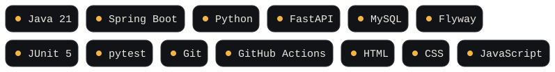

 

 

### Sobre mim

Estudante de **Análise e Desenvolvimento de Sistemas** na USJT, **em busca de estágio em TI**. Gosto de construir sistemas completos, do banco de dados à tela, e de deixar tudo testado, documentado e acessível.

 

### Em destaque

<table>
<tr>
<td width="56%" valign="top">

</td>
<td valign="top">
<h4><a href="https://github.com/nevessdhiego-design/nexodesk">NexoDesk</a></h4>

Helpdesk para condomínios, feito em grupo na faculdade. O morador abre chamados, o sistema estima a dificuldade e monta a fila do síndico (emergência primeiro), e a equipe atende com checklist, foto e conversa em tempo real.

<ul>
<li>Java 21, Spring Boot 4 e serviço de regras em Python (FastAPI)</li>
<li>MySQL/H2 com migrações Flyway</li>
<li>191 testes Java e 20 Python, CI no GitHub Actions</li>
<li>Segurança, modo escuro e alto contraste</li>
<li>Trabalho por pull request, com riscos e revisões registrados</li>
</ul>
</td>
</tr>
</table>

**Também:** [Meu Financeiro](https://github.com/nevessdhiego-design/meu-financeiro), app de finanças pessoais que roda no navegador e pode ser instalado como aplicativo (PWA), em HTML, CSS e JavaScript.

 

### Tecnologias dos meus projetos

 

### Estudando agora

Engenharia de software (Sommerville), UML, gerência de configuração e de riscos, e boas práticas de teste.

